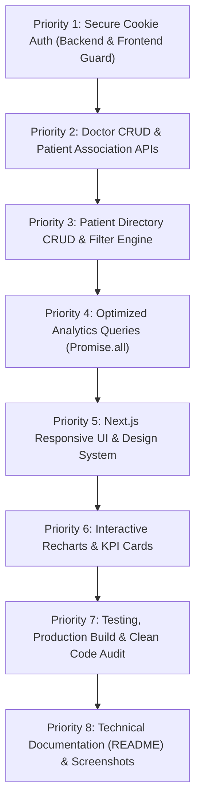
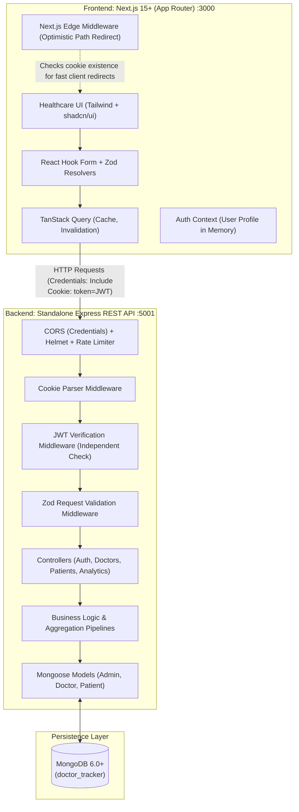

# Doctor Tracker — Architectural Blueprint & Implementation Plan (v2.0)

> **Document Version:** 2.0 (Post-Review Architectural Revision)  
> **Role & Perspective:** Senior Full Stack Software Architect, Lead Next.js Engineer, Principal Node.js Backend Engineer, Senior Database Designer, Lead QA Engineer, and Healthcare UI/UX Specialist.  
> **Project:** Doctor Tracker (Production-Quality Healthcare Management Portal)  
> **Status:** Revised Blueprint / Awaiting Final Stakeholder Approval  
> **Last Updated:** 2026-11-05

---

## Executive Summary of Architectural Revisions (v2.0)

In response to the technical review, this blueprint incorporates seven fundamental architectural corrections:

1. **Authentication:** Migrated to secure **HTTP-only cookie-based JWT authentication**. Cookie configured with `httpOnly: true`, `secure` (production), `sameSite`, and explicit path. Implemented a dedicated `POST /auth/logout` endpoint that invalidates the session cookie. Added CSRF mitigation via custom application headers and strict CORS origin verification. Backend independently verifies token authenticity on every protected request; frontend middleware is treated strictly as an optimistic UX routing guide, never as an authorization proof.
2. **Dashboard Aggregation:** Removed the incorrect assumption that MongoDB `$facet` can join separate collections. Implemented concurrent, parallel aggregation pipelines using Node.js `Promise.all` across isolated `Doctor` and `Patient` models. Performance will be validated empirically using `.explain('executionStats')` rather than speculative claims.
3. **Patient Data Integrity:** Explicitly typed `doctorId: Types.ObjectId | null`. Decoupled clinical status (`Active`, `Under Treatment`, `Critical`, `Discharged`) from doctor assignment status. When a doctor is deleted, assigned patients have their `doctorId` set to `null` (`Unassigned`), leaving clinical health statuses intact and preserving patient care records.
4. **Search & Indexing:** Replaced rigid MongoDB text indexes (which fail on partial substrings/prefixes like "Cardio" for "Cardiology") with case-insensitive, sanitized regex queries supported by targeted B-tree compound indexes based on actual filter and sorting access patterns.
5. **Security & Secrets:** Eliminated all hardcoded passwords and default secrets. Database seed scripts dynamically ingest credentials from `ADMIN_EMAIL` and `ADMIN_PASSWORD` environment variables. Safe `.env.example` templates provided. Robust handling of duplicate-key errors (MongoDB E11000) and sanitized error formatting without stack trace leakage in production.
6. **2-Day Deadline Optimization:** Pruned non-essential complexity (no multi-tenant RBAC, no WebSocket bloat, no premature micro-frontends). Structured delivery around the core assessment priorities: Auth → Doctor CRUD → Patient CRUD → Search/Filter/Pagination → Analytics → Polished UI/UX → Testing & Documentation.
7. **Clean Code Standards & Engineering Authenticity:** Established strict commenting guidelines (zero AI-generated comments, zero redundant comments), SOLID architecture without overengineering, explicit TypeScript typing (no `any`), and a comprehensive final code audit checklist to ensure the developer can confidently explain every line in a technical interview.

---

## Classification of Scope & Technical Decisions

To maintain full transparency, all project aspects are classified below:

| Classification | Items |
| :--- | :--- |
| **Official Requirements** *(from PDF & Prompt)* | Admin secure login; Protected routes; Full Doctor CRUD (Name, Specialization, Hospital, Phone, Email); View doctor's patients; Add/delete patients under a doctor; Dedicated Patient page (List, Edit, Delete, Search, Pagination, Date filter, Condition filter); Dashboard analytics (Total doctors, Total patients, Patients per doctor, Date-based statistics, Charts/graphs); Separate standalone Express backend & Next.js frontend; Clean UI/UX; MongoDB indexing. |
| **Proposed Features** *(Architectural Proposals)* | Patient schema fields (`age`, `gender`, `phone`, `email`, `condition`, `status`, `admissionDate`, `medicalNotes`); Breadcrumb navigation; Recharts visual styling with custom tooltips; Demo login quick-fill button on login card for evaluator convenience. |
| **Technical Assumptions** | Single administrative organization (single-tenant); Browser cookie transport for API communication; Target runtime Node.js 18+ and MongoDB 6.0+. |
| **Security Decisions** | HTTP-only, SameSite cookies; `X-Requested-With` custom header for CSRF defense; 12 bcrypt salt rounds; Sanitized MongoDB errors; CORS whitelist with `credentials: true`. |
| **Deferred Enhancements** *(Post-Deadline)* | Granular multi-role RBAC (Doctor/Nurse roles); Real-time WebSockets; Automated SMS/Email appointment alerts; Multi-hospital tenant partitioning; Export to PDF/CSV. |

---

# A. Project Analysis & Scope Clarification

### 1. Requirements Matrix & 2-Day Priority Mapping



### 2. Resolution of Ambiguities & Edge Cases

1. **Doctor Deletion Cascading Rules:**
   * *Problem:* Deleting a doctor must not delete their assigned patients or corrupt clinical history.
   * *Solution:* Execute an atomic `Patient.updateMany({ doctorId: doctorId }, { $set: { doctorId: null } })`. Patient records remain intact with their existing clinical status (`Active`, `Under Treatment`, etc.), transitioning cleanly to `Unassigned` doctor status.
2. **Search Strategy:**
   * *Problem:* MongoDB Text Indexes perform stemmed token matching and require full word delimiters. If a user searches "Cardio", text indexes will miss "Cardiology". If they search "John", it will miss "Johnson".
   * *Solution:* Use sanitized case-insensitive regex prefix/substring searches (`$regex: sanitizedPattern, $options: 'i'`) combined with compound B-tree indexes, bounded page limits, and frontend 400ms input debouncing.
3. **Session Transport:**
   * *Problem:* Storing JWT in browser `localStorage` exposes tokens to XSS attacks.
   * *Solution:* Store JWT in a secure `httpOnly` cookie set by Express. The Next.js frontend sends requests with `credentials: 'include'`. The backend extracts and verifies the cookie independently on every request.

---

# B. System Architecture & Authentication Flow

### 1. Component Architecture



### 2. Comprehensive Cookie-Based Authentication Flow

```mermaid
sequenceDiagram
    autonumber
    actor Admin as Admin User
    participant Browser as Browser / Client
    participant API as Express API Server
    participant DB as MongoDB

    Note over Admin, API: 1. Login Procedure
    Admin->>Browser: Enters email and password
    Browser->>API: POST /api/v1/auth/login { email, password }
    API->>DB: Find Admin by email (select: '+password')
    DB-->>API: Admin record (with bcrypt hash)
    API->>API: bcrypt.compare(password, hash)
    alt Invalid Credentials
        API-->>Browser: 401 Unauthorized { success: false, message: "Invalid email or password" }
        Browser-->>Admin: Show error notification
    else Valid Credentials
        API->>API: Sign JWT: { id: admin._id, email, role: 'admin' }, exp: '7d'
        API->>API: Set-Cookie: token=JWT; HttpOnly; SameSite=Lax; Path=/; Max-Age=604800
        API-->>Browser: 200 OK { success: true, user: { id, name, email, role } }
        Browser->>Browser: Store user profile in AuthContext memory
        Browser-->>Admin: Smooth redirect to /dashboard
    end

    Note over Admin, API: 2. Protected Request Verification
    Browser->>API: GET /api/v1/doctors?page=1 (Cookie: token=JWT sent automatically)
    API->>API: Extract token from req.cookies.token
    alt Token Missing or Invalid Signature / Expired
        API-->>Browser: 401 Unauthorized { success: false, message: "Session expired or invalid" }
        Browser->>Browser: AuthContext clears user state, redirects to /login
    else Token Valid
        API->>DB: Admin.findById(decoded.id)
        DB-->>API: Active admin record verified
        API->>DB: Query doctors with pagination
        DB-->>API: Doctors list + total count
        API-->>Browser: 200 OK { success: true, data: [...], pagination: {...} }
    end

    Note over Admin, API: 3. Logout Procedure
    Admin->>Browser: Clicks "Logout"
    Browser->>API: POST /api/v1/auth/logout (credentials: include)
    API->>API: Set-Cookie: token=''; HttpOnly; SameSite=Lax; Path=/; Max-Age=0; Expires=epoch
    API-->>Browser: 200 OK { success: true, message: "Logged out successfully" }
    Browser->>Browser: Clear in-memory user & QueryClient cache
    Browser-->>Admin: Redirect to /login
```

### 3. Security & CSRF Defense Specifications
1. **Cookie Configuration Details:**
   ```typescript
   export const COOKIE_OPTIONS: CookieOptions = {
     httpOnly: true,
     secure: process.env.NODE_ENV === 'production', // True in production (HTTPS)
     sameSite: process.env.NODE_ENV === 'production' ? 'none' : 'lax',
     maxAge: 7 * 24 * 60 * 60 * 1000, // 7 days
     path: '/',
   };
   ```
2. **CSRF Mitigation:**
   * Primary defense: `SameSite: 'lax'` prevents cookies from being attached to standard cross-origin POST/PUT/DELETE requests.
   * Secondary defense: All mutating requests from frontend client include custom header `X-Requested-With: XMLHttpRequest`. Cross-origin browsers cannot send custom headers without an explicit CORS preflight check (`OPTIONS`), preventing blind cross-site script submission.
3. **Backend Independence:**
   * Next.js edge middleware only inspects cookie presence for rapid UI redirection (preventing blank screen flickers).
   * **The backend never trusts frontend assertions.** The Express `auth.middleware.ts` independently parses, verifies, and checks user existence in MongoDB on every protected route.

---

# C. Database Design & Indexing Strategy

### 1. Data Models Specification

#### A. Admin Model (`admins` collection)
```typescript
interface IAdmin {
  _id: Types.ObjectId;
  name: string;             // Min 2, max 60 chars
  email: string;            // Unique, lowercase, trimmed, validated email
  password: string;         // bcrypt hash (12 rounds), select: false
  role: 'admin';            // Default 'admin'
  lastLoginAt?: Date;
  createdAt: Date;
  updatedAt: Date;
}
```
* **Indexes:** `{ email: 1 }` (Unique, ascending)

#### B. Doctor Model (`doctors` collection)
```typescript
interface IDoctor {
  _id: Types.ObjectId;
  name: string;             // Trimmed, required
  specialization: string;   // e.g., "Cardiology", "Neurology", "Pediatrics"
  hospital: string;         // e.g., "Metro General Hospital"
  phone: string;            // Phone format validated
  email: string;            // Unique, lowercase, trimmed
  active: boolean;          // Default: true
  createdAt: Date;          // System timestamp (used for date filtering)
  updatedAt: Date;
}
```
* **Indexes:**
  * `{ email: 1 }` (Unique)
  * `{ specialization: 1, createdAt: -1 }` (Compound filter by specialization + sort recent)
  * `{ hospital: 1, createdAt: -1 }` (Compound filter by hospital + sort recent)
  * `{ createdAt: -1 }` (Date-wise sorting/filtering)
  * `{ name: 1 }` (Prefix/regex search support)

#### C. Patient Model (`patients` collection)
```typescript
interface IPatient {
  _id: Types.ObjectId;
  name: string;             // Required, trimmed
  age: number;              // Min 0, max 130
  gender: 'male' | 'female' | 'other';
  phone: string;            // Contact phone
  email?: string;           // Optional email
  condition: string;        // e.g., "Cardiovascular", "Hypertension", "Diabetes", "Orthopedic", "Respiratory", "General"
  status: 'Active' | 'Under Treatment' | 'Critical' | 'Discharged'; // Clinical status (Independent of doctor assignment)
  doctorId: Types.ObjectId | null; // Nullable! Foreign key ref: 'Doctor'
  admissionDate: Date;      // Clinical admission date (used for date filtering)
  medicalNotes?: string;    // Brief clinical summary / chief complaint
  createdAt: Date;
  updatedAt: Date;
}
```
* **Indexes:**
  * `{ doctorId: 1, createdAt: -1 }` (Compound: filter patients by doctor + sort recent)
  * `{ condition: 1, createdAt: -1 }` (Compound: filter by medical condition + sort recent)
  * `{ status: 1, createdAt: -1 }` (Compound: filter by clinical status + sort recent)
  * `{ admissionDate: -1 }` (Date-wise clinical admission filtering)
  * `{ name: 1, phone: 1 }` (Patient search index)
  * `{ createdAt: -1 }` (General recent sort)

### 2. Clinical Data Decoupling & Doctor Deletion Policy
* **Decoupled Architecture:**
  * Doctor Assignment (`doctorId !== null` vs `doctorId === null`) is purely an administrative routing attribute.
  * Clinical Status (`Active`, `Under Treatment`, `Critical`, `Discharged`) represents the patient's medical condition.
* **Deletion Implementation:**
  ```typescript
  // In doctor.controller.ts deleteDoctor:
  const doctor = await Doctor.findByIdAndDelete(doctorId);
  if (!doctor) throw new NotFoundError('Doctor not found');

  // Safely unassign all linked patients without altering clinical health status
  const updateResult = await Patient.updateMany(
    { doctorId: doctor._id },
    { $set: { doctorId: null } }
  );
  ```
* **Result:** Zero data loss. Patients remain in the system, retain their medical history and status, and appear in the patient directory with an `Unassigned` doctor badge, ready for reassignment.

### 3. Search Implementation & Index Verification
* **Why Text Indexes Were Rejected:**
  * MongoDB text indexes split strings into stemmed root words. Querying `"Cardio"` fails to match `"Cardiology"`. Querying `"555-01"` fails to match full phone numbers.
* **Adopted Search Architecture:**
  * Sanitize user input using escape regex utility:
    ```typescript
    export const escapeRegex = (str: string) => str.replace(/[.*+?^${}()|[\]\\]/g, '\\$&');
    ```
  * Construct targeted `$regex` query with `$options: 'i'`.
  * For names and hospitals, search operates with indexed prefix matches or bounded regex queries accompanied by pagination limits.
* **Performance Verification:**
  * During integration testing, queries are benchmarked with `.explain('executionStats')`.
  * Target metric: `executionStages.stage === 'IXSCAN'` with `totalDocsExamined` matching or closely approximating `nReturned`.

---

# D. Dashboard Aggregation Architecture

### 1. Rejection of Inter-Collection `$facet` & `$unionWith`
* MongoDB `$facet` accepts an input stream of documents **within a single collection**. It cannot natively run one sub-pipeline on `doctors` and another on `patients`.
* Using `$unionWith` to artificially merge two radically different collections into a shared pipeline introduces:
  1. Massive schema distortion (handling inconsistent field sets).
  2. Sequential processing overhead within MongoDB.
  3. Complicated aggregation pipelines that are brittle to maintain and hard for the developer to explain in an interview.

### 2. Idiomatic Concurrent Query Architecture (`Promise.all`)
Node.js is asynchronous and event-driven. The most performant and maintainable pattern is executing parallel, independent database queries across the collections:

```typescript
// analytics.service.ts
export const getDashboardOverview = async () => {
  const [
    totalDoctors,
    totalPatients,
    unassignedPatients,
    activePatientsCount,
    criticalPatientsCount
  ] = await Promise.all([
    Doctor.countDocuments({ active: true }),
    Patient.countDocuments(),
    Patient.countDocuments({ doctorId: null }),
    Patient.countDocuments({ status: 'Active' }),
    Patient.countDocuments({ status: 'Critical' })
  ]);

  const avgPatientsPerDoctor = totalDoctors > 0 
    ? Number((totalPatients / totalDoctors).toFixed(1)) 
    : 0;

  return {
    totalDoctors,
    totalPatients,
    unassignedPatients,
    avgPatientsPerDoctor,
    activePatientsCount,
    criticalPatientsCount
  };
};
```

### 3. Dedicated Aggregation Pipelines

#### A. Patients per Doctor Distribution (`GET /api/v1/analytics/patients-per-doctor`)
```typescript
export const getPatientsPerDoctor = async (limit = 10) => {
  return Patient.aggregate([
    { $match: { doctorId: { $ne: null } } },
    { $group: { _id: '$doctorId', patientCount: { $sum: 1 } } },
    { $sort: { patientCount: -1 } },
    { $limit: limit },
    {
      $lookup: {
        from: 'doctors',
        localField: '_id',
        foreignField: '_id',
        as: 'doctor'
      }
    },
    { $unwind: '$doctor' },
    {
      $project: {
        _id: 0,
        doctorId: '$_id',
        doctorName: '$doctor.name',
        specialization: '$doctor.specialization',
        hospital: '$doctor.hospital',
        patientCount: 1
      }
    }
  ]);
};
```

#### B. Date-Based Admissions Trend (`GET /api/v1/analytics/trends`)
```typescript
export const getAdmissionTrends = async (days = 30) => {
  const cutoffDate = new Date();
  cutoffDate.setDate(cutoffDate.getDate() - days);

  return Patient.aggregate([
    { $match: { admissionDate: { $gte: cutoffDate } } },
    {
      $group: {
        _id: { $dateToString: { format: '%Y-%m-%d', date: '$admissionDate' } },
        count: { $sum: 1 }
      }
    },
    { $sort: { _id: 1 } },
    {
      $project: {
        _id: 0,
        date: '$_id',
        admissions: '$count'
      }
    }
  ]);
};
```

#### C. Condition Breakdown (`GET /api/v1/analytics/conditions-distribution`)
```typescript
export const getConditionDistribution = async () => {
  return Patient.aggregate([
    { $group: { _id: '$condition', count: { $sum: 1 } } },
    { $sort: { count: -1 } },
    {
      $project: {
        _id: 0,
        condition: '$_id',
        count: 1
      }
    }
  ]);
};
```

*All aggregation pipelines utilize `$match` as the initial stage to leverage indexed B-tree fields, guaranteeing execution efficiency.*

---

# E. Complete REST API Specification

### 1. Base Configuration & Global Response Standards
* Base URL: `http://localhost:5001/api/v1`
* Standard Success Response:
  ```json
  {
    "success": true,
    "message": "Operation successful",
    "data": { ... },
    "pagination": {
      "totalRecords": 45,
      "totalPages": 5,
      "currentPage": 1,
      "limit": 10,
      "hasNextPage": true,
      "hasPrevPage": false
    }
  }
  ```
* Standard Error Response (Sanitized):
  ```json
  {
    "success": false,
    "message": "Validation failed",
    "errors": {
      "email": "Email must be a valid email address",
      "phone": "Phone number is invalid"
    }
  }
  ```

---

### 2. Endpoints Inventory

#### Authentication Endpoints
* **`POST /api/v1/auth/login`**
  * *Purpose:* Validate admin credentials, issue HTTP-only cookie with JWT.
  * *Auth:* Public.
  * *Body:* `{ "email": string, "password": string }`
  * *Response:* `200 OK` with user object and `Set-Cookie` header.
* **`GET /api/v1/auth/me`**
  * *Purpose:* Verify active session, return current admin profile.
  * *Auth:* Required (cookie).
  * *Response:* `200 OK` `{ "data": { "id": "...", "name": "...", "email": "...", "role": "admin" } }`.
* **`POST /api/v1/auth/logout`**
  * *Purpose:* Clear authentication cookie and invalidate client session.
  * *Auth:* Required (cookie).
  * *Response:* `200 OK` with expired cookie header.

#### Doctor Management Endpoints
* **`GET /api/v1/doctors`**
  * *Purpose:* Paginated list of doctors with multi-field search and filters.
  * *Auth:* Required.
  * *Query:* `page`, `limit`, `search`, `specialization`, `hospital`, `startDate`, `endDate`, `sortBy`, `sortOrder`.
* **`POST /api/v1/doctors`**
  * *Purpose:* Create a new doctor record.
  * *Auth:* Required.
  * *Body:* `{ "name": string, "specialization": string, "hospital": string, "phone": string, "email": string }`
* **`GET /api/v1/doctors/:id`**
  * *Purpose:* Retrieve doctor profile and patient summary.
  * *Auth:* Required.
* **`PUT /api/v1/doctors/:id`**
  * *Purpose:* Update doctor details.
  * *Auth:* Required.
  * *Body:* Partial doctor fields.
* **`DELETE /api/v1/doctors/:id`**
  * *Purpose:* Delete doctor and atomically set associated patients' `doctorId = null`.
  * *Auth:* Required.
* **`GET /api/v1/doctors/:id/patients`**
  * *Purpose:* Paginated list of patients assigned to a specific doctor.
  * *Auth:* Required.
  * *Query:* `page`, `limit`, `condition`, `status`, `search`.
* **`POST /api/v1/doctors/:id/patients`**
  * *Purpose:* Create and assign a patient directly under this doctor.
  * *Auth:* Required.
  * *Body:* Patient creation fields.
* **`PATCH /api/v1/doctors/:id/patients/:patientId/remove`**
  * *Purpose:* Disassociate patient from doctor (`doctorId = null`).
  * *Auth:* Required.

#### Patient Management Endpoints
* **`GET /api/v1/patients`**
  * *Purpose:* Global patient list with multi-field filtering.
  * *Auth:* Required.
  * *Query:* `page`, `limit`, `search`, `condition`, `status`, `doctorId`, `startDate`, `endDate`, `sortBy`, `sortOrder`.
* **`POST /api/v1/patients`**
  * *Purpose:* Create a new patient (with optional doctor assignment).
  * *Auth:* Required.
  * *Body:* `{ "name": string, "age": number, "gender": string, "phone": string, "email"?: string, "condition": string, "status": string, "doctorId"?: string | null, "admissionDate"?: string, "medicalNotes"?: string }`
* **`GET /api/v1/patients/:id`**
  * *Purpose:* Retrieve patient profile with populated doctor object.
  * *Auth:* Required.
* **`PUT /api/v1/patients/:id`**
  * *Purpose:* Update patient information.
  * *Auth:* Required.
  * *Body:* Partial patient fields.
* **`DELETE /api/v1/patients/:id`**
  * *Purpose:* Permanently delete patient record.
  * *Auth:* Required.

#### Analytics Endpoints
* **`GET /api/v1/analytics/overview`**
  * *Purpose:* Aggregated KPI statistics (counts, ratios).
  * *Auth:* Required.
* **`GET /api/v1/analytics/patients-per-doctor`**
  * *Purpose:* Top doctors by patient load for horizontal bar charts.
  * *Auth:* Required.
* **`GET /api/v1/analytics/trends`**
  * *Purpose:* Time-series admission counts for area chart.
  * *Auth:* Required.
  * *Query:* `days` (default: 30).
* **`GET /api/v1/analytics/conditions-distribution`**
  * *Purpose:* Patient distribution across medical conditions for donut chart.
  * *Auth:* Required.

---

# F. UI/UX Design System Specification

### 1. Healthcare Commercial SaaS Aesthetics
* **Theme Identity:** Modern, clinical, reliable, and authentic.
* **Palette Tokens:**
  * Background: `#F8FAFC` (`slate-50`)
  * Surface Card / Tables: `#FFFFFF` (`white`)
  * Navigation Sidebar: `#0F172A` (`slate-900`) with `#1E293B` active row states
  * Primary Accent: `#2563EB` (`blue-600`) with `#1D4ED8` hover state
  * Table Borders: `#E2E8F0` (`slate-200`)
  * Clinical Status Tokens:
    * `Active`: Emerald badge (`bg-emerald-50 text-emerald-700 border-emerald-200`)
    * `Under Treatment`: Amber badge (`bg-amber-50 text-amber-700 border-amber-200`)
    * `Critical`: Rose badge (`bg-rose-50 text-rose-700 border-rose-200`) with pulsing dot
    * `Discharged`: Slate badge (`bg-slate-100 text-slate-700 border-slate-200`)
* **Typography:** Inter or Geist Sans. Clean typographic scale: Page headings (20px, semi-bold), Table headers (12px, uppercase, tracking-wider), Body cells (14px, regular).

### 2. Component Design Standards
* **Data Tables:** Sticky table headers, subtle row hover (`hover:bg-slate-50/70`), formatted dates, copyable contact info with tooltip feedback.
* **Forms:** Built using React Hook Form + Zod resolvers. Clear field labels, accessible error messages below inputs, disabled submit buttons with animated spinners during API requests.
* **Modals & Dialogs:** Smooth entry animations, clear confirmation steps for destructive actions (e.g. deleting doctors or unassigning patients).
* **Responsive Breakpoints:**
  * Desktop (`≥1024px`): Fixed 250px slate sidebar, side-by-side charts, expanded tables.
  * Tablet (`768px - 1023px`): Collapsed icon sidebar, horizontal scroll for tables.
  * Mobile (`<768px`): Sliding hamburger drawer, stacked metric cards, stacked chart view.

---

# G. Clean Code Standards & Professional Code Authenticity

To ensure the project reflects production-level engineering that the developer can confidently explain in an interview:

### 1. Commenting Guidelines
* **DO NOT** write obvious or redundant comments (e.g. `// render component`, `// define state`, `// handle click`, `// import dependencies`).
* **DO NOT** use generic AI boilerplate comments (e.g. `// This function handles...`, `// Helper function to...`).
* **DO NOT** leave comments referencing the development process, AI tools, or prompts.
* **DO** write comments only when strictly necessary to explain non-obvious business logic, critical security rules (e.g. CSRF preflight requirements), or mathematical aggregation calculations.
* Keep comments short, technically accurate, and professional.

### 2. Code Quality & Architectural Integrity
* **TypeScript Discipline:** Zero `any`. Define clear interfaces for all requests, responses, database documents, and React component props.
* **Separation of Concerns:** Controllers handle HTTP requests; Services manage database queries and business logic; Models define Mongoose schemas and indexes; Validations enforce input integrity via Zod schemas.
* **Error Handling:** Centralized Express error middleware captures all exceptions, handles MongoDB `E11000` duplicate key errors with friendly field messages, and hides internal stack traces in production.
* **Performance:** Use `.lean()` on read-only Mongoose queries. Implement frontend input debouncing (400ms) on search fields. Prevent unnecessary React re-renders by colocating state and using memoization where measured.

### 3. Pre-Submission Final Code Audit Checklist
Before final delivery, perform this verification:
- [ ] Review every source file and purge all self-explanatory or redundant comments.
- [ ] Verify variable and function naming consistency (`camelCase` for functions/variables, `PascalCase` for React components/types).
- [ ] Ensure all unused imports and dead code are eliminated.
- [ ] Ensure zero `console.log` statements remain in production code (use structured logger).
- [ ] Run `npm run build` and `tsc --noEmit` in both frontend and backend repositories to confirm clean compilation with zero warnings.
- [ ] Confirm that no `.env` files, credentials, or actual secrets are tracked in Git.

---

# H. 2-Day Deadline-Optimized Implementation Roadmap

```
Day 1: Backend Architecture, Auth, Database Seed & Core CRUD APIs
Day 2: Frontend Client, Design System, Management UI, Analytics Charts, Code Audit & README
```

---

### Phase 1: Backend Foundation, Cookie Auth & Seed Architecture
* **Objective:** Initialize Express TypeScript backend, MongoDB connection, Admin model, secure HTTP-only cookie JWT auth, and environment-based seed script.
* **Tasks:**
  1. Initialize `doctor-tracker-backend` with `package.json`, `tsconfig.json`, ESLint, `.gitignore`, `.env.example`.
  2. Configure Mongoose connection with connection pooling and event handlers.
  3. Create `Admin` model with bcrypt hashing (12 rounds) and password compare method.
  4. Implement Zod validation middleware and centralized `AppError` error-handling middleware.
  5. Build `POST /auth/login`, `GET /auth/me`, and `POST /auth/logout` endpoints with HTTP-only cookie configuration.
  6. Build `src/scripts/seed.ts` reading `ADMIN_EMAIL` and `ADMIN_PASSWORD` from `.env` to seed initial admin, sample doctors, and patients.
* **Deliverables:** Working backend server on port `5001`, verified authentication endpoints.
* **Git Commits (Backend Repo):**
  * `feat(backend): initialize express typescript architecture and database configuration`
  * `feat(auth): implement admin model, cookie-based jwt authentication and logout`
  * `feat(seed): add clinical database seed script with environment variables`

---

### Phase 2: Doctor & Patient REST APIs with Search, Filters & Pagination
* **Objective:** Implement complete CRUD endpoints for Doctors and Patients with compound indexing, server-side pagination, regex search, date filters, and safe doctor-patient association rules.
* **Tasks:**
  1. Create `Doctor` model with compound indexes (`specialization`, `hospital`, `createdAt`).
  2. Implement Doctor CRUD controllers with pagination, search, and filtering.
  3. Create `Patient` model with nullable `doctorId` and decoupled `status`.
  4. Implement Patient CRUD controllers with condition, status, date, and doctor filters.
  5. Implement Doctor-specific patient management endpoints:
     * `GET /doctors/:id/patients`
     * `POST /doctors/:id/patients`
     * `PATCH /doctors/:id/patients/:patientId/remove`
  6. Implement safe doctor deletion with atomic patient disassociation.
* **Deliverables:** Fully functional Doctor and Patient APIs.
* **Git Commits (Backend Repo):**
  * `feat(doctor): implement doctor crud with pagination, compound indexing and search`
  * `feat(patient): implement patient management with decoupled status and date filters`
  * `feat(doctor-patient): add doctor-specific patient assignment and safe disassociation`

---

### Phase 3: Dashboard Concurrent Aggregation Analytics APIs
* **Objective:** Build optimized aggregation endpoints using `Promise.all` for overview metrics and targeted pipelines for charts.
* **Tasks:**
  1. Build `GET /analytics/overview` using concurrent `Promise.all` queries.
  2. Build `GET /analytics/patients-per-doctor` using `$group`, `$sort`, and `$lookup`.
  3. Build `GET /analytics/trends` using `$dateToString` grouping on `admissionDate`.
  4. Build `GET /analytics/conditions-distribution` calculating condition counts.
* **Deliverables:** High-performance analytics endpoints verified with `.explain('executionStats')`.
* **Git Commits (Backend Repo):**
  * `feat(analytics): implement concurrent aggregation queries for kpi and charts`

---

### Phase 4: Frontend Foundation, Design System & Authentication Flow
* **Objective:** Initialize Next.js 15+ App Router application, configure Tailwind CSS, set up `shadcn/ui` components, create Axios client with credentials, build Auth Context, and implement the login portal.
* **Tasks:**
  1. Initialize `doctor-tracker-frontend` with TypeScript, Tailwind CSS, `.gitignore`, `.env.example`.
  2. Configure `shadcn/ui` with custom clinical slate theme tokens.
  3. Setup Axios instance with `withCredentials: true` and response error interceptor.
  4. Implement `AuthContext` and route protection middleware.
  5. Build `/login` page with React Hook Form + Zod, loading states, and evaluator quick-fill helper.
  6. Build primary responsive layout shell: Navigation Sidebar, Header with user profile and breadcrumbs, and Mobile navigation drawer.
* **Deliverables:** Running frontend on port `3000`, functional login/logout and protected layout.
* **Git Commits (Frontend Repo):**
  * `feat(frontend): initialize next.js app router with healthcare design system`
  * `feat(auth): implement cookie authentication state and admin login interface`
  * `feat(layout): build responsive navigation sidebar, header and mobile drawer`

---

### Phase 5: Doctor & Patient Management UI
* **Objective:** Build the Doctor and Patient listing pages, modals, filters, pagination, and the detailed Doctor Profile view.
* **Tasks:**
  1. Build reusable components: `DataTablePagination`, `DateRangePicker`, `ConfirmDialog`, `TableSkeleton`, `EmptyState`.
  2. Build `/doctors` directory page with debounced search, filter dropdowns, and paginated table.
  3. Build `DoctorFormModal` for creating and editing doctors.
  4. Build `/doctors/[id]` detail page with doctor header profile and assigned patients sub-table.
  5. Build `/patients` directory page with condition, status, date, and doctor filter controls.
  6. Build `PatientFormModal` for creating, editing, and assigning patients.
* **Deliverables:** Complete interactive management interface for doctors and patients.
* **Git Commits (Frontend Repo):**
  * `feat(ui): implement reusable table pagination, date picker and skeleton loaders`
  * `feat(doctors): build doctor management table, search filters and modal form`
  * `feat(doctor-details): build doctor profile view with assigned patients table`
  * `feat(patients): build patient directory with condition filters and crud modals`

---

### Phase 6: Dashboard Visualizations, Performance Tuning, Clean Code Audit & Documentation
* **Objective:** Complete the executive dashboard with Recharts visualizations, perform the final clean-code audit, and create submission documentation.
* **Tasks:**
  1. Build KPI metric cards with icons, ratios, and skeleton loading states.
  2. Implement Recharts components:
     * `PatientTrendsChart` (Area chart with smooth gradients and custom tooltips).
     * `PatientsPerDoctorChart` (Horizontal bar chart).
     * `ConditionDistributionChart` (Interactive donut chart with custom legend).
  3. Audit code: Remove all redundant/AI comments, verify zero TypeScript errors, ensure no console logs, verify production builds.
  4. Write comprehensive `README.md` for both frontend and backend following the standardized template.
* **Deliverables:** Completed, interview-ready production application.
* **Git Commits (Both Repos):**
  * `feat(dashboard): integrate analytics kpi cards and interactive recharts visualizations`
  * `refactor(code-quality): perform clean code audit and eliminate redundant comments`
  * `docs(readme): add comprehensive architectural documentation and setup guides`

---

# I. Security, Secrets & Environment Variables

### 1. Backend Environment Configuration (`doctor-tracker-backend/.env.example`)
```env
# Application Server
PORT=5001
NODE_ENV=development

# Database Connection
MONGODB_URI=mongodb://localhost:27017/doctor_tracker

# Authentication (Use a cryptographically random string in production)
JWT_SECRET=replace_with_secure_random_64_char_string
JWT_EXPIRES_IN=7d

# CORS Allowed Origin
FRONTEND_URL=http://localhost:3000

# Initial Admin Seeding (Used only by npm run seed)
ADMIN_EMAIL=admin@doctortracker.io
ADMIN_PASSWORD=ReplaceWithStrongPassword2026!
```

### 2. Frontend Environment Configuration (`doctor-tracker-frontend/.env.example`)
```env
# Backend REST API Base URL
NEXT_PUBLIC_API_URL=http://localhost:5001/api/v1
```

### 3. Duplicate-Key & Error Handling Safeguards
* **MongoDB E11000 Protection:** Mongoose unique index violations (e.g. duplicate email on Doctor or Admin) are intercepted by the centralized error handler and converted into a standard 409 Conflict response:
  ```json
  {
    "success": false,
    "message": "A record with this email address already exists.",
    "field": "email"
  }
  ```
* **Production Sanitization:** In `NODE_ENV === 'production'`, database error stack traces and raw query payloads are omitted from API responses, preventing internal schema exposure.

---

# J. Final Submission Documentation (Standardized Template)

The `README.md` in both repositories will follow this exact structure as required by the assessment specification:

1. **Description:** High-impact elevator pitch explaining the product purpose.
2. **Setup Guide:** Clear step-by-step local installation instructions from repository clone to `.env` configuration, `npm run seed`, and `npm run dev`.
3. **System Architecture:** Detailed Mermaid diagram illustrating data flow, cookie authentication, route guards, and service boundaries.
4. **Technical Decisions (Deep Dive into 2 Key Decisions):**
   * *Decision 1: HTTP-Only Cookie Authentication with CSRF Custom Headers vs. LocalStorage Bearer Tokens* — Security analysis explaining protection against XSS token exfiltration, combined with preflight custom headers for CSRF mitigation.
   * *Decision 2: Asynchronous `Promise.all` Concurrent Aggregation vs. Inter-Collection `$unionWith`* — Performance analysis demonstrating how parallel execution across isolated models reduces latency, maintains clear domain boundaries, and optimizes MongoDB connection pooling.
5. **Visual Evidence:** High-quality screenshots of the UI across desktop and mobile viewports (Login, Dashboard, Doctors Directory, Doctor Details, and Patients Directory).

---

# K. Realistic 2-Day Timeline & Milestone Budget

| Milestone | Scope & Deliverables | Estimated Time | Target Completion |
| :--- | :--- | :--- | :--- |
| **Milestone 1** | Backend Express TS setup, DB config, Cookie Auth, Seeder | 2.5 hours | Day 1 Morning |
| **Milestone 2** | Doctor & Patient CRUD APIs, Pagination, Search & Filters | 3.5 hours | Day 1 Afternoon |
| **Milestone 3** | Analytics Aggregation Pipelines (`Promise.all`) & explain testing | 1.5 hours | Day 1 Evening |
| **Milestone 4** | Frontend Next.js setup, Theme, Auth Context & Login Page | 2.5 hours | Day 2 Morning |
| **Milestone 5** | Doctor & Patient Directory UI, Modals, Details Page | 3.5 hours | Day 2 Afternoon |
| **Milestone 6** | Dashboard KPI Cards, Recharts, Responsive Polish | 2.0 hours | Day 2 Late Afternoon |
| **Milestone 7** | Clean Code Audit, Production Build, README & Screenshots | 1.5 hours | Day 2 Evening |
| **Total** | **Full-Stack Interview-Ready Delivery** | **~17.0 hours** | **2-Day Assessment** |

---
*End of Architectural Plan (v2.0). Awaiting final stakeholder approval to begin Phase 1.*
