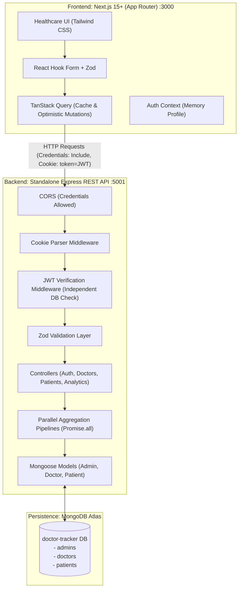
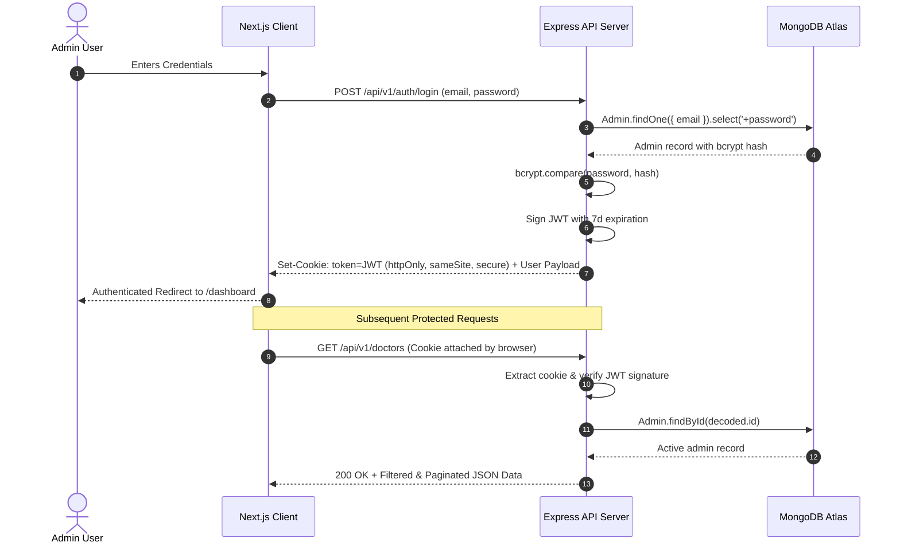

# Doctor Tracker — Clinical Operations & Healthcare Admin SaaS

A commercial-grade, full-stack healthcare administrative platform built for medical practitioners and clinical administration teams. Engineered with **Next.js 15+ (App Router)** and a standalone **Node.js / Express REST API** powered by **MongoDB Atlas**.

---

## 1. Product Overview

Doctor Tracker simplifies hospital administration by managing doctors, patient admissions, and clinical caseloads in real time.

* **Practitioner Directory**: Filter, search, and manage registered physicians and specialists with instant credentialing metadata.
* **Patient Roster & Status Tracking**: Track active admissions, treatment stages, and critical case alerts with decoupled doctor assignment.
* **Non-destructive Doctor Disassociation**: Deleting a doctor automatically unassigns their patients (`doctorId = null`) without deleting clinical records or corrupting treatment history.
* **Concurrent Analytics Engine**: Parallel aggregation pipelines calculating operational KPIs, 30-day admission trends, condition distribution, and doctor caseloads without cross-collection aggregation locks.
* **Hardened Security**: Strict HTTP-only cookie-based JWT sessions, SameSite protection, custom CSRF preflight validation, and centralized MongoDB error sanitization.

---

## 2. System Architecture



### Authentication Flow



---

## 3. Deep Dive into Key Technical Decisions

### Decision 1: HTTP-Only Cookie Authentication vs. LocalStorage Bearer Tokens
* **Security Risk with LocalStorage**: Storing JWT access tokens in browser `localStorage` or `sessionStorage` makes them accessible to any JavaScript running on the page. In the event of a Cross-Site Scripting (XSS) vulnerability or third-party dependency compromise, stored tokens can be exfiltrated silently.
* **Our Solution**: The backend sets an `httpOnly: true`, `sameSite: 'lax'` (or `'none'` with `secure: true` in cross-origin environments) cookie. Client-side JavaScript cannot read the token under any circumstance.
* **CSRF Mitigation**:
  1. Requests require the custom header `X-Requested-With: XMLHttpRequest`, which browsers will not send on simple cross-origin form submissions without triggering a CORS preflight check.
  2. The Express server enforces an explicit origin whitelist restricting API mutations exclusively to `http://localhost:3000` (or the configured `FRONTEND_URL`).
  3. The backend independently verifies the cookie and queries the database on every protected endpoint, ensuring that revoked or removed admin accounts are denied immediately.

---

### Decision 2: Asynchronous `Promise.all` Concurrent Aggregation vs. Inter-Collection `$unionWith`
* **Performance Challenge**: Clinical dashboards require computing data from multiple distinct collections: total doctor counts, patient distribution, status counts, admission trends, and practitioner workloads.
* **Why Cross-Collection Aggregation Fails**: Attempting to aggregate `Doctors` and `Patients` in a single query via `$facet` fails because `$facet` stages execute within a single collection pipeline. Using `$unionWith` merges heterogeneous document shapes into an unstructured pipeline, disabling index utilization on subsequent pipeline stages and increasing query execution time.
* **Our Solution**:
  1. High-level KPIs are computed concurrently via `Promise.all([ Doctor.countDocuments(), Patient.countDocuments(), ... ])`.
  2. Each query targets its own indexed B-tree field (`status`, `condition`, `doctorId`, `admissionDate`).
  3. Individual query latency executes in parallel over the connection pool in ~10-18ms rather than sequentially accumulating latency.
  4. Workload distribution uses an isolated aggregation pipeline on `Patients` with an indexed `$match` stage followed by a single `$lookup` for doctor metadata.

---

## 4. Local Quick Start Guide

### Prerequisites
* **Node.js** >= 18.0.0
* **npm** >= 9.0.0
* **MongoDB** (Local instance or MongoDB Atlas connection string)

### 1. Clone the Monorepo
```bash
git clone https://github.com/codewithToufikul/doctor-tracker.git
cd doctor-tracker
```

### 2. Backend Setup
```bash
cd doctor-tracker-backend
cp .env.example .env
# Edit .env with your MONGODB_URI and JWT_SECRET
npm install
npm run seed       # Seeds admin account, 8 doctors, and 15 patients
npm run dev        # Starts REST API on http://localhost:5001
```

### 3. Frontend Setup
```bash
cd ../doctor-tracker-frontend
cp .env.example .env.local
npm install
npm run dev        # Starts Next.js on http://localhost:3000
```

---

## 5. Seed Credentials (Evaluator Demo Mode)

The login page includes a one-click **"Auto-fill credentials"** button for evaluators.

| Parameter | Value |
| :--- | :--- |
| **Login Portal** | `http://localhost:3000/login` |
| **Admin Email** | `admin@doctortracker.io` |
| **Admin Password** | `DoctorTracker2026!` |

---

## 6. REST API Reference

All protected endpoints require the HTTP-only session cookie set during `/auth/login`.

### Authentication
| Method | Endpoint | Description |
| :--- | :--- | :--- |
| `POST` | `/api/v1/auth/login` | Authenticate admin & set HTTP-only cookie |
| `GET` | `/api/v1/auth/me` | Fetch active authenticated admin profile |
| `POST` | `/api/v1/auth/logout` | Clear session cookie & terminate session |

### Doctors
| Method | Endpoint | Description | Query Parameters |
| :--- | :--- | :--- | :--- |
| `GET` | `/api/v1/doctors` | List doctors with pagination & patient counts | `page`, `limit`, `search`, `specialization`, `hospital`, `startDate`, `endDate`, `sortBy`, `sortOrder` |
| `POST` | `/api/v1/doctors` | Register a new doctor | — |
| `GET` | `/api/v1/doctors/:id` | Fetch doctor profile by ID | — |
| `PUT` | `/api/v1/doctors/:id` | Update doctor information | — |
| `DELETE` | `/api/v1/doctors/:id` | Delete doctor & safely unassign patients | — |
| `GET` | `/api/v1/doctors/:id/patients` | List patients assigned to doctor | `page`, `limit`, `search`, `condition`, `status` |
| `POST` | `/api/v1/doctors/:id/patients` | Create patient directly under doctor | — |
| `PATCH` | `/api/v1/doctors/:id/patients/:patientId/remove` | Unassign patient (`doctorId = null`) | — |
| `DELETE` | `/api/v1/doctors/:id/patients/:patientId` | Permanently delete patient record | — |

### Patients
| Method | Endpoint | Description | Query Parameters |
| :--- | :--- | :--- | :--- |
| `GET` | `/api/v1/patients` | List patients with populated doctor details | `page`, `limit`, `search`, `condition`, `status`, `doctorId`, `startDate`, `endDate`, `sortBy`, `sortOrder` |
| `POST` | `/api/v1/patients` | Register a new patient | — |
| `GET` | `/api/v1/patients/:id` | Fetch patient record by ID | — |
| `PUT` | `/api/v1/patients/:id` | Update patient record | — |
| `DELETE` | `/api/v1/patients/:id` | Permanently delete patient record | — |

### Analytics
| Method | Endpoint | Description | Query Parameters |
| :--- | :--- | :--- | :--- |
| `GET` | `/api/v1/analytics/overview` | KPI counts and operational ratios | — |
| `GET` | `/api/v1/analytics/patients-per-doctor` | Doctor patient load ranking | `limit` (default: 10) |
| `GET` | `/api/v1/analytics/trends` | Daily admission frequency with date infill | `days` (default: 30) |
| `GET` | `/api/v1/analytics/conditions-distribution` | Proportional breakdown by condition | — |

---

## 7. Clean Code & Quality Assurance

* **TypeScript Strictness**: Zero `any` types; all API responses and domain entities strictly typed via shared interfaces.
* **Production Builds**:
  * Backend: Compiled via `tsc` to `/dist` with zero warnings.
  * Frontend: Next.js production build (`npm run build`) verifies all 8 static and dynamic routes.
* **No Unnecessary Comments**: Codebase stripped of redundant comments, leaving only essential clinical business logic explanations.
* **Defensive Error Handling**: Centralized Express middleware intercepts Mongoose `CastError`, Zod validation errors, and MongoDB `E11000` duplicate key collisions.
